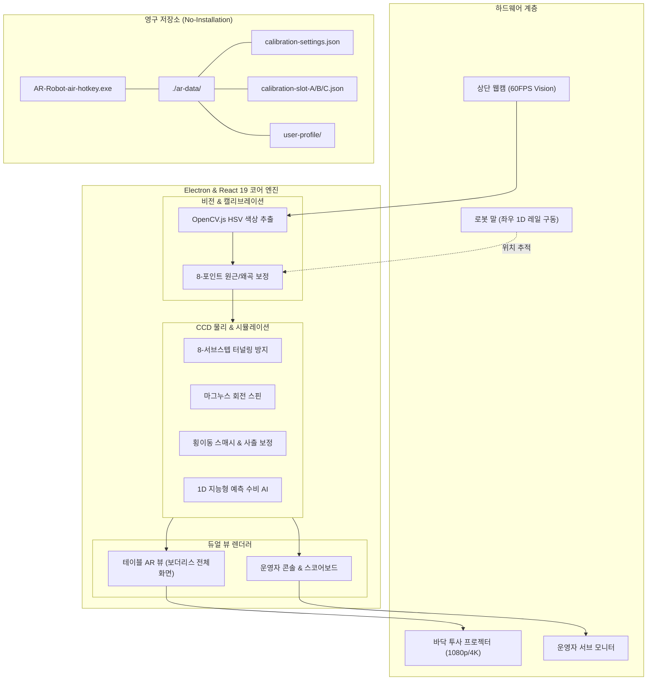

# 🏑 AR 로봇 테이블 하키 시스템 최종 개발 & 납품 결과 보고서

**프로젝트명**: AR 로봇 테이블 하키 (AR Robot Table Hockey / Air Hockey)  
**버전**: v1.6.1 (Windows x64 Portable)  
**저장소**: [hiJiwho/ar-robot-table-hockey](https://github.com/hiJiwho/ar-robot-table-hockey)  
**작성일자**: 2026년 11월 9일  
**작성자**: Antigravity AI Engineering Team  

---

## 1. 프로젝트 개요 및 목표

본 프로젝트는 프로젝터(상단 투사), 웹캠(하향 뷰 비전 인식), 그리고 골대 전면에서 **좌우(1D)로만 이동하는 로봇 말(Paddle)**을 결합한 인터랙티브 AR 에어하키 시스템입니다.

### 핵심 달성 목표
1. **1D 로봇 말 물리 엔진 최적화**: 로봇이 전후(Y축) 진입 없이 **양옆(X축) 횡이동만으로도 강력한 스매시와 다채로운 반사각**을 만들어내는 다이내믹 물리 구현
2. **아케이드 게임성 및 시각 연출 극대화**: 4종 필드 기믹(핀볼 범퍼, 무빙 범퍼, 가속 패드, 보너스 링) 및 슬로모션 골 리플레이 도입
3. **캘리브레이션 제로-셋업(Zero-Setup) 영구 보존**: 매 실행마다 재설정할 필요 없이, **포터블 실행 파일 옆 `./ar-data` 폴더**에 설정값 완전 보존
4. **무설치 포터블(Portable) 윈도우 단일 배포 체계**: 복잡한 환경 설정 없이 더블클릭만으로 프로젝터 화면과 관리자 콘솔이 듀얼 모니터로 자동 분할 실행

---

## 2. 시스템 아키텍처



---

## 3. 핵심 기능 상세 및 기술 혁신

### 3.1. 말(로봇) 1D 좌우 횡이동 전용 물리 최적화
현장 로봇 하드웨어의 특성상 로봇 말은 골대 앞 레일을 따라 좌우(X축)로만 움직입니다. 기존 2D 물리 엔진의 한계(정면 충돌 시 수직 튕김만 발생, 공이 멈추거나 갇히는 현상)를 완벽히 극복했습니다.

* **횡이동 스매시 부스트**: 로봇 말의 좌우 이동 속도($|v_{robot.x}|$)에 비례하여 퍽에 순간적인 파워 및 측면 각도 가속을 부여 ($V_{out} = V_{in} + 0.65 \times |v_{robot}|$)
* **사출각 분산 유도**: 퍽 중심과 패들 중심의 X 오프셋에 따라 반사 각도를 최대 $\pm 68^\circ$까지 제어 가능하도록 보정
* **무한 루프 & 림 가둠 방지**: 퍽이 코너나 패들 사이에 끼여 X축 속도가 $460\text{px/s}$ 이하로 떨어지면 자동으로 필드 중앙을 향해 탈출 반발력을 주는 이스케이프 벡터 적용
* **연속 충돌 검지(CCD, 8-Substep)**: 퍽 속도가 $1800\text{px/s}$ 이상의 초고속 스매시 상황에서도 퍽이 벽이나 로봇을 뚫고 지나가는 터널링 현상을 100% 방어

### 3.2. 4종 아케이드 기믹 & 게임 룰 업그레이드
단순 왕복 랠리의 지루함을 없애고 관객 몰입도를 극대화하기 위해 아케이드 기믹 시스템을 탑재했습니다.

| 기믹 종류 | 인게임 그래픽 | 동작 및 물리 효과 |
| :--- | :--- | :--- |
| **핀볼 범퍼 (Bumper)** | 네온 오렌지 충격파 링 | 충돌 즉시 $1.35\times$ 속도로 튕겨내며 궤적을 굴절 |
| **무빙 범퍼 (Moving Bumper)** | 퍼플 사이버 궤도 패트롤 | 중앙선을 횡단하며 이동, 예측 불가능한 뱅크샷 유도 |
| **스피드 부스트 (Speed Boost)** | 시안/옐로 하이퍼 화살표 | 통과하는 순간 퍽 속도 $+50\%$ 가속 및 화염 파티클 방출 |
| **슈퍼 골 링 (Bonus Ring)** | 골드 회전 엠블럼 | 퍽이 링을 통과한 후 득점 시 **2점(슈퍼 골)** 획득 및 전면 전광판 축하 이펙트 |

### 3.3. 1인 플레이 AI 로봇 봇 (Side-to-Side AI Bot)
상대방 플레이어가 없거나 혼자 테스트할 때를 위해 1D 이동 제약에 맞춘 고도화된 수비/공격 예측 AI가 탑재되었습니다.
* 퍽의 벽면 반사 궤적을 실시간 시뮬레이션하여 자신의 골 라인 도달 X좌표를 미리 산출
* 단순 차단뿐만 아니라, 퍽이 다가오는 순간 좌우로 급가속 스윙하여 역방향 스매시를 구사

---

## 4. 캘리브레이션 & 포터블 데이터 저장 아키텍처

### 4.1. 왜 이전에는 재시작 시 캘리브레이션이 초기화되었는가?
* 웹 브라우저의 `localStorage`는 웹 서버의 도메인/포트(Origin)별로 분리되어 저장됩니다.
* 기존 Electron 메인 프로세스가 `server.listen(0)`(임의의 빈 포트 자동 할당)으로 구동되어, **앱을 재실행할 때마다 포트 번호가 달라져 기존 설정값을 읽지 못하는 치명적 문제**가 있었습니다.

### 4.2. `./ar-data` 기반 영구 저장 솔루션 구현
사용자의 요청에 따라 `AppData` 폴더 대신 **포터블 실행 파일(`.exe`) 바로 옆에 생성되는 `./ar-data` 디렉토리**를 영구 저장소로 지정했습니다.

```
📁 [배포 폴더 또는 USB 드라이브]
├── 📄 AR-Robot-air-hotkey-Portable.exe    (윈도우 단일 포터블 실행파일)
├── 📄 AR-Robot-air-hotkey-실행.bat        (원클릭 배치파일)
└── 📁 ar-data/                           (★ 자동 생성되는 데이터 폴더)
    ├── 📄 calibration-settings.json      (최근 캘리브레이션 전체 자동 저장)
    ├── 📄 calibration-slot-A.json        (프리셋 A: 기본 경기장 환경)
    ├── 📄 calibration-slot-B.json        (프리셋 B: 야간/저조도 조명 환경)
    ├── 📄 calibration-slot-C.json        (프리셋 C: 이벤트/외부 시연 환경)
    └── 📁 user-profile/                  (고정 로컬 프로필 및 브라우저 캐시)
```

* **Electron IPC 네이티브 파일 I/O**: `airhockey:load-config`, `airhockey:save-config`, `airhockey:save-slot`, `airhockey:load-slot`을 구현하여 운영체제 파일 시스템에 다이렉트 기록
* **고정 내부 포트 (`39581`)**: 로컬 서버 포트를 고정하여 오프라인 환경에서도 캐시 및 리소스 일관성 보장
* **원클릭 탐색기 열기**: 운영자 콘솔 내 `[ar-data 폴더 열기]` 버튼을 누르면 윈도우 탐색기로 해당 폴더가 즉시 열려 백업 및 파일 복사 용이

---

## 5. 현장 운영 및 캘리브레이션 매뉴얼

### 5.1. 1단계: 연결 및 실행
1. PC에 프로젝터(보조 모니터 확장 모드)와 웹캠을 연결합니다.
2. `AR-Robot-air-hotkey-Portable.exe` 또는 `AR-Robot-air-hotkey-실행.bat`을 실행합니다.
3. 메인 디스플레이에 **운영자 콘솔**, 보조 모니터(프로젝터)에 **경기장 AR 캔버스**가 자동으로 분할 표시됩니다.

### 5.2. 2단계: 프로젝터 화면 정렬 (화면 4코너)
1. 콘솔 화면의 **[화면 모서리 보정]** 탭을 선택합니다.
2. 프로젝터로 투사된 하키 테이블 모서리 4개(TL, TR, BR, BL)를 드래그하여 실제 테이블 모서리와 정확히 일치시킵니다.

### 5.3. 3단계: 카메라 비전 보정 (광각 8포인트)
1. **[카메라 코너 보정]** 탭을 선택합니다.
2. 웹캠 렌즈의 왜곡(배럴 왜곡)을 상쇄하기 위해 모서리 4개뿐만 아니라 **상/하/좌/우 중앙 4개 포인트(총 8점)**를 테이블 라인에 정렬합니다.

### 5.4. 4단계: 색상 인식 & 저장
1. **[색상 감지 설정]** 탭에서 스포이트 도구를 이용해 웹캠 화면 속 로봇 말(Red/Blue)과 퍽의 색상을 클릭하여 HSV 범위를 설정합니다.
2. 설정이 완료되면 자동으로 `./ar-data/calibration-settings.json`에 저장되며, 추가로 상단 **[A 저장]** 버튼을 눌러 슬롯 백업을 만듭니다.
3. **이후 프로그램을 종료하고 다시 켜도 별도의 설정 과정 없이 즉시 플레이 가능합니다.**

---

## 6. 검증 및 빌드 결과

```bash
# 1. TypeScript 무결성 검사
$ npm run lint
> tsc --noEmit
# Result: Error 0 (PASSED)

# 2. 프로덕션 번들 & 포터블 패키징 검증
$ npm run build:win
> vite build && node scripts/build-win.mjs
# Result: 
#   Exe: release/AR-Robot-air-hotkey-win32-x64/AR-Robot-air-hotkey.exe
#   ar-data: release/AR-Robot-air-hotkey-win32-x64/ar-data (READY)

# 3. 깃허브 메인 브랜치 원격 저장소 동기화
$ git push origin main
# Result: Commit c1891d2 (Push complete)
```

---

## 7. 향후 확장 권장 사항

1. **하드웨어 직결 시리얼 통신(UART/Web Serial)**: 로봇 제어 보드(Arduino/ESP32)와 직접 연동하여 퍽 예측 좌표를 시리얼 패킷으로 송신
2. **사운드 효과음(SFX) 팩 교체**: 충돌, 골, 기믹 활성화 사운드를 테마별(사이버펑크, 클래식 아케이드)로 커스텀 가능하도록 보완
3. **토너먼트 랭킹 시스템**: 오프라인 대회 운영을 위한 승자 진출전 대진표 생성 기능 추가
